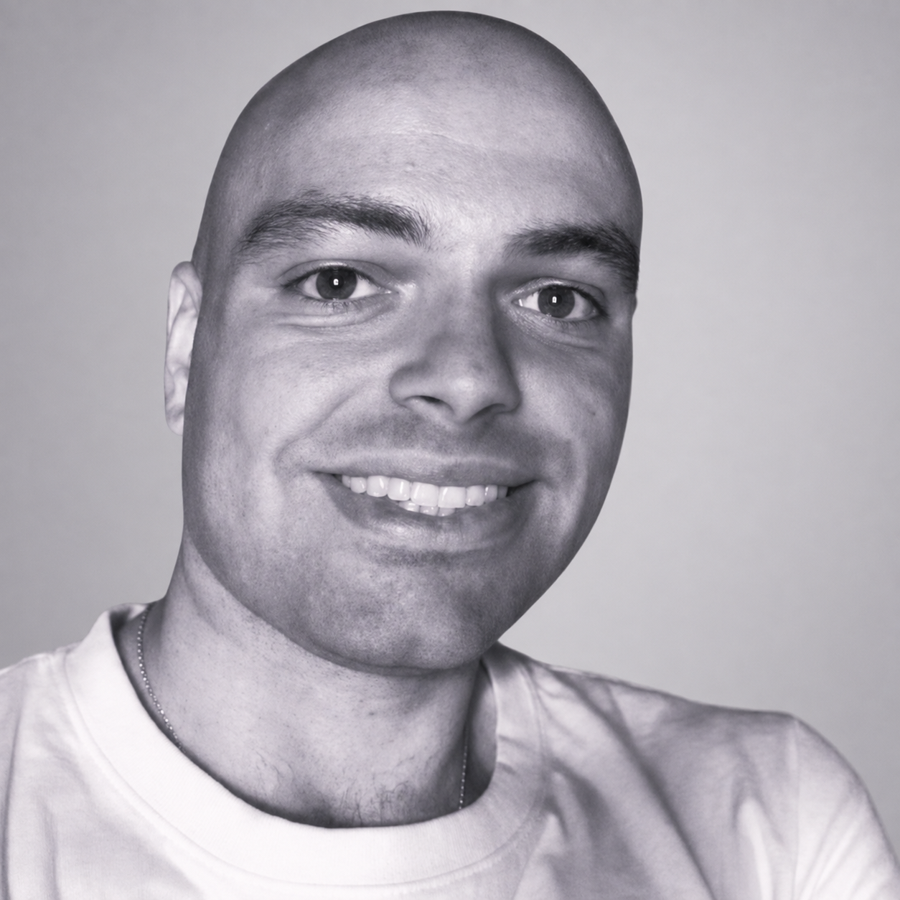

<!-- Keep in sync with index.html (same sections, same order). -->

  

<h1 align="center">Ricard Santiago Raigada García</h1>

  <strong>PhD Candidate</strong> 
  Universitat Politècnica de Catalunya (UPC) 
  Barcelona Supercomputing Center (BSC) 
  <em>Accelerators &amp; Communications for HPC (AccelCom)</em> 
  Barcelona, Spain

  <a href="https://torodata.github.io/ToroData/">Website</a> ·
  <a href="https://orcid.org/0009-0009-9684-4745">ORCID</a> ·
  <a href="https://arxiv.org/search/?searchtype=author&amp;query=Garc%C3%ADa-Raigada%2C+Ricard">arXiv</a> ·
  <a href="https://github.com/ToroData">GitHub</a> ·
  <a href="https://www.linkedin.com/in/ricard-santiago-raigada-garcia/">LinkedIn</a>

---

## About

I am a PhD candidate at the **Universitat Politècnica de Catalunya (UPC)** and the **Barcelona Supercomputing Center (BSC)**, where I am part of the *Accelerators and Communications for HPC* (AccelCom) group. My research focuses on the integration of **quantum processors into high-performance computing**: how to schedule, distribute and orchestrate quantum workloads alongside classical resources in a supercomputing centre.

My background combines physics and computer engineering: an MSc in Computer Engineering and an MSc in Advanced Physics, studies in Data Science, together with the MIT MicroMasters in Statistics and Data Science. Before the PhD I worked as a data scientist and machine learning engineer on cloud-native (AWS) systems.

### Research interests

`Hybrid HPC–quantum computing` `Quantum circuit cutting` `Scheduling & resource management` `Distributed quantum workloads` `Quantum software stacks` `Machine learning for systems`

## Publications

Full list on [ORCID](https://orcid.org/0009-0009-9684-4745).

### Preprints

- **2026** — **Wave-Based Dispatch for Circuit Cutting in Hybrid HPC–Quantum Systems**  
  ***R. S. García-Raigada***, J. Jorba, S. Iserte  
  *arXiv:2604.15279 [cs.DC]*  
  DQR (Dynamic Queue Router), a runtime that treats circuit-cutting fragments as schedulable units, so HPC centres can apply standard resource management to NISQ workloads. Evaluated on the CESGA Qmio supercomputer with its local QPU and the remote IBM Torino backend, with per-fragment failover to classical simulators.  
  [arXiv](https://arxiv.org/abs/2604.15279) · [PDF](https://arxiv.org/pdf/2604.15279)

### Theses, reports & other works

- **2025** — **Emergent Geometrodynamic Intelligence in Transformers: Lagrangian Dynamics, Gauge Symmetries, and Holographic Emergence**  
  ***R. S. Raigada García***  
  *Universitat Oberta de Catalunya · Zenodo*  
  [DOI](https://doi.org/10.5281/zenodo.15772617)

- **2025** — **Quantum Database Architecture for the Quantum Data Scientist: A Theoretical Treatise on Lindblad Operators, EIT in Multi-Level Atomic Ensembles, and High-Fidelity Data Encoding**  
  ***R. S. Raigada García***  
  *Master's thesis, Universitat Oberta de Catalunya*  
  [DOI](https://doi.org/10.5281/zenodo.14810946) · [UOC repository](http://hdl.handle.net/10609/152040) · [Code](https://github.com/ToroData/Quantum-Database-Architecture-for-the-Quantum-Data-Scientist-Thesis)

- **2025** — **Symmetries in Quantum Mechanics: from Klein-Gordon Equation to Higgs Mechanism**  
  ***R. S. Raigada García***  
  *Zenodo (MITx 8.06x)*  
  [DOI](https://doi.org/10.5281/zenodo.14774610)

- **2024** — **Optimizing Quantum Circuits for Efficient Execution on Superconducting Hardware: A Case Study of the Cuccaro Adder**  
  ***R. S. Raigada García***  
  *Technical report, Universitat Oberta de Catalunya*  
  [DOI](https://doi.org/10.13140/RG.2.2.24291.77608) · [UOC repository](http://hdl.handle.net/10609/150164)

## Talks & Posters

Conferences, workshops and poster sessions.

- **2026** — **Wave-Based Dispatch for Circuit Cutting in Hybrid HPC–Quantum Systems**  
  `Poster` ACM ICS · Belfast, Ireland · July 2026

## Research Positions

| When | Position |
|---|---|
| 2026 – present | **PhD Candidate** — Barcelona Supercomputing Center · Universitat Politècnica de Catalunya AccelCom group. Runtime systems and scheduling for hybrid HPC–quantum infrastructures. |

## Education

| When | Degree |
|---|---|
| 2026 – present | **PhD** — Universitat Politècnica de Catalunya (UPC) |
| 2025 – 2026 | **MSc in Advanced Physics** — UNED, Madrid |
| 2025 | **Data Science** — Universitat Oberta de Catalunya (UOC) Thesis: *Quantum Database Architecture for the Quantum Data Scientist*. |
| | **MSc in Computer Engineering** — Universitat Oberta de Catalunya (UOC) |

### Selected advanced programmes

- **MicroMasters in Statistics and Data Science** — Massachusetts Institute of Technology (MITx)
- **Quantum Computing Realities** — Massachusetts Institute of Technology (MIT xPRO)
- **Quantum Computer Systems Design** — University of Chicago
- **Machine Learning, Mathematics and Computer Science** — Stanford University

## Service & Recognition

- **Reviewer** — *Journal of Parallel and Distributed Computing* (Elsevier), 2026
- **IBM Qiskit Advocate**
- **3rd place**, AWS DeepRacer National Championship, 2023
- **AWS Certified Solutions Architect – Associate**

## Skills

| | |
|---|---|
| **Quantum** | Qiskit, circuit cutting, quantum algorithms, quantum information |
| **HPC & Systems** | Scheduling, runtime systems, distributed computing, Linux |
| **Programming** | Python, scientific computing, machine learning, deep learning |
| **Cloud** | AWS (SageMaker, Lambda, Step Functions, Braket) |
| **Languages** | Catalan & Spanish (native), English (professional) |

## Contact

I'm happy to talk about hybrid HPC–quantum systems, collaborations, or research stays. The easiest way to reach me is through [LinkedIn](https://www.linkedin.com/in/ricard-santiago-raigada-garcia/).

---

© 2026 Ricard Santiago Raigada García · Last updated October 2026
